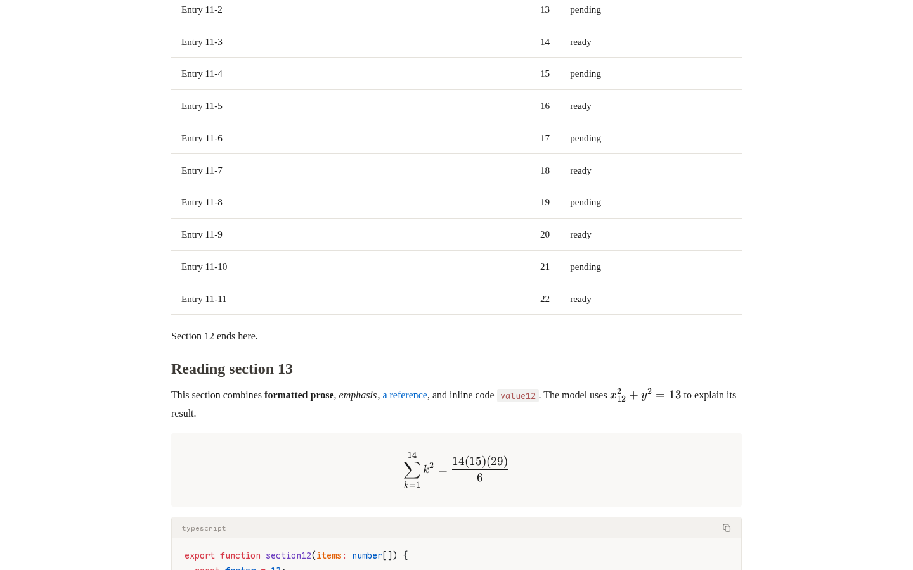

# Renderer performance report

[Documentation](README.md) · [简体中文](../zh-CN/performance.md)

Measured on **2026-10-14 (Asia/Shanghai)**. LiMR **1.0.1**, react-markdown **10.1.0**, Markstream React **2.0.19**, React/React DOM **19.3.0**, Node **v20.19.5**, Chromium **156.0.8078.4**. 13th Gen Intel(R) Core(TM) i7-13700; 24 logical CPUs; 31.2 GiB; linux 6.18.40.1-microsoft-standard-WSL2.

This report describes the measurements from this run. Dependencies come from the lockfile; competitor packages were not upgraded. Suites ran serially without CPU/network throttling on a shared workstation with resident editor processes. Narrow viewports are Chromium simulations, not physical phones. Each JSON records environment/load, source and lockfile SHA-256, and every sample.

## Findings

For controlled full-DOM mounting of 877,782 characters, Markstream has the lowest median (814.60ms). The tables also expose ranges, memory, DOM, streaming and default-reading acceptance; a single fastest result does not imply an overall winner.

Mixed streaming commit totals: **LiMR 288.60ms / react-markdown 1919.80ms / Markstream 335.20ms**; growing code: **LiMR 153.80ms / react-markdown 287.20ms / Markstream 181.10ms**. The table and single-paragraph results differ, illustrating that stable-prefix reuse benefits depend on content structure.

| Default-reading scenario | LiMR | react-markdown | Markstream |
| --- | --- | --- | --- |
| rich-medium | 3/3 passed | 3/3 passed | 0/3 passed |
| rich-large | 3/3 passed | 3/3 passed | 0/3 passed |
| rich-mobile | 3/3 passed | 3/3 passed | 2/3 passed |

Frame, memory or initial timing from a failed reading run is not a usability advantage. KP is optional; renderer comparisons use standard typography. See the separate [Knuth–Plass performance report](knuth-plass-performance.md).

## Configuration and comparability

LiMR uses this repository’s `src` compiled by production Vite; competitors use npm packages pinned by pnpm. These are local source measurements, not remote measurements of a deployed site or published LiMR artifact.

| Profile | LiMR | react-markdown | Markstream |
| --- | --- | --- | --- |
| Controlled full DOM | Markdown + gfm, interactive=false | remark-gfm | maxLiveNodes=0; batch/defer/viewportPriority/smooth/typewriter/fade=false; native pre |
| Rich reading / streaming | Default Markdown, modules, animations, styles and font | remark-gfm + remark-math + rehype-katex + async Shiki | Default MarkdownRender, virtualization, animations and styles; stream-diffs and KaTeX installed |

The rich react-markdown setup is an explicit integration, not its bare defaults. It uses Shiki github-light/github-dark and KaTeX. Vendor CSS/fonts and deferral differ, so rich reading compares integration behavior; controlled full DOM uses identical neutral CSS. Setup follows the [react-markdown documentation](https://github.com/remarkjs/react-markdown) and [Markstream React documentation](https://markstream.simonhe.me/frameworks/react); measured versions are in the JSON.

## Full-DOM mounting and streaming

Five independent pages, two small warmups, cyclic/reversed renderer order. Values are median [min–max] in ms. Streaming appends 256 UTF-16 characters per update with one rAF between updates and includes final nonstreaming commit. Synchronous time includes React flushSync and forced layout, excluding idle frames and async resources; raw data also records TaskDuration, layout, long tasks and rAF.

| Scenario / characters | LiMR | react-markdown | Markstream |
| --- | --- | --- | --- |
| static-small / 8,700 | 21.30 [20.30–179.90] | 19.10 [17.80–21.20] | 17.20 [15.20–18.10] |
| static-medium / 87,381 | 154.50 [111.40–288.00] | 126.90 [108.50–817.60] | 102.10 [91.00–208.80] |
| static-large / 877,782 | 1269.40 [1236.60–78177.90] | 1203.80 [1169.10–1309.70] | 814.60 [802.30–832.30] |
| stream-mixed / 34,860 | 288.60 [276.90–606.90] | 1919.80 [1871.50–3178.80] | 335.20 [305.60–470.10] |
| stream-code / 34,488 | 153.80 [144.00–157.20] | 287.20 [281.40–290.80] | 181.10 [179.70–184.10] |
| stream-table / 30,922 | 1897.40 [1863.50–1964.90] | 1921.50 [1878.90–1958.30] | 746.60 [677.00–777.50] |
| stream-paragraph / 32,500 | 1874.40 [1846.30–1910.50] | 1533.10 [1519.40–1573.70] | 1077.40 [1014.50–1120.50] |

The following stalls exceed five times their group median and remain in all statistics and raw data. Timings alone cannot establish whether input, browser scheduling, system load or another cause is responsible; the median does not describe this tail risk.

| Scenario / renderer / trial | Commit ms | TaskDuration ms | LayoutDuration ms |
| --- | --- | --- | --- |
| static-small / LiMR / 1 | 179.90 | 183.06 | 1.27 |
| static-medium / react-markdown / 3 | 817.60 | 830.32 | 468.28 |
| static-large / LiMR / 1 | 78177.90 | 78282.65 | 25387.26 |

A follow-up for the long-document stall starts new Node and Chromium processes, reuses the same production build, and measures three fresh pages per renderer. It does not replace the five primary samples or establish the cause of the stall. Repeat values are median [min–max] ms.

| LiMR | react-markdown | Markstream |
| --- | --- | --- |
| 1224.40 [1172.60–1357.70] | 1146.40 [1096.70–1264.90] | 770.50 [763.70–882.90] |

[mount-repeat.json](../../benchmarks/results/mount-repeat.json).


### Streaming update P95 / worst update

| Scenario | LiMR | react-markdown | Markstream |
| --- | --- | --- | --- |
| stream-mixed | 3.10 / 175.50 | 24.80 / 183.10 | 3.70 / 45.40 |
| stream-code | 1.50 / 9.60 | 3.50 / 8.20 | 2.10 / 3.10 |
| stream-table | 26.70 / 48.20 | 27.80 / 57.70 | 10.00 / 19.80 |
| stream-paragraph | 26.10 / 49.30 | 20.80 / 77.20 | 15.60 / 31.90 |

P95 is the median of per-trial update P95s; worst update is the maximum across all trials. This is not end-to-end frame time or a 16.7ms guarantee. Every full-DOM sample validates headings, prose, lists, tables and fenced-code text outside timing.

### Retained heap and DOM

| Scenario | LiMR MiB / DOM | react-markdown MiB / DOM | Markstream MiB / DOM |
| --- | --- | --- | --- |
| static-small | 0.71 / 402 | 0.21 / 361 | 1.55 / 1521 |
| static-medium | 5.95 / 4002 | 1.43 / 3601 | 13.05 / 15201 |
| static-large | 57.05 / 40002 | 13.09 / 36001 | 126.34 / 152001 |
| stream-mixed | 5.85 / 2977 | 1.54 / 1441 | 8.76 / 6289 |
| stream-code | 1.73 / 29 | 0.67 / 3 | 1.10 / 5 |
| stream-table | 7.18 / 4221 | 1.67 / 2408 | 10.64 / 7992 |
| stream-paragraph | 10.39 / 5009 | 1.66 / 1502 | 14.38 / 9699 |

Heap is the post-GC increment over the warmed empty page, not browser-process RSS. DOM counts cover article elements only.

### Main-thread tasks / layout time

| Scenario | LiMR ms | react-markdown ms | Markstream ms |
| --- | --- | --- | --- |
| static-small | 23.91 / 1.27 | 21.61 / 1.25 | 21.05 / 1.55 |
| static-medium | 164.13 / 11.23 | 137.34 / 11.51 | 238.41 / 17.42 |
| static-large | 1342.15 / 119.70 | 1302.33 / 120.16 | 997.84 / 180.15 |
| stream-mixed | 766.79 / 78.51 | 2032.55 / 43.29 | 627.35 / 74.59 |
| stream-code | 531.90 / 214.23 | 414.00 / 85.37 | 315.13 / 88.47 |
| stream-table | 2496.14 / 229.53 | 2072.59 / 91.51 | 1133.45 / 163.51 |
| stream-paragraph | 2955.66 / 457.27 | 1653.38 / 97.43 | 1571.53 / 345.92 |

These are medians of CDP TaskDuration / LayoutDuration deltas. Layout is included in task time and must not be added a second time.

## Rich streaming with defaults preserved

Eight sections of unique TypeScript/Python/JSON, formulas, tables, tasks and local images; three resource-warmed pages per renderer. Final checks require eight headings, the end marker and ready visible rich blocks. Commit time is separated from CDP task cost, which includes asynchronous work and settling probes.

| Renderer | Passed | Commit total ms | P95 ms | TaskDuration ms |
| --- | --- | --- | --- | --- |
| LiMR | 3/3 | 190.70 [190.30–194.40] | 4.10 | 631.33 |
| react-markdown | 3/3 | 1257.10 [1253.60–1272.40] | 20.30 | 1624.60 |
| Markstream | 3/3 | 216.80 [211.00–220.00] | 3.40 | 699.46 |

## Default reading: cold load, scrolling and seeks

rich-medium and rich-mobile have 24 sections; rich-large has 240 (831,559 characters, 240 code blocks, 480 formulas, 30 local images). Desktop is 1440×900 and narrow viewport 390×900. Three cold browser contexts per case record first nonempty content and stable visible content from navigation. First content is a DOM + two-rAF proxy; settling requires repeated identical snapshots. Neither is FCP/LCP.

| Scenario / renderer | Passed | First content ms | Stable ms | Scroll P95 / max ms | Final heap MiB |
| --- | --- | --- | --- | --- | --- |
| rich-medium / LiMR | 3/3 | 225.00 | 786.80 | 16.70 / 16.80 | 13.66 |
| rich-medium / react-markdown | 3/3 | 218.20 | 733.70 | 16.70 / 16.80 | 8.82 |
| rich-medium / Markstream | 0/3 | 170.20 | 815.60 | 16.70 / 33.30 | 15.47 |
| rich-large / LiMR | 3/3 | 1240.00 | 2576.50 | 16.80 / 33.40 | 44.93 |
| rich-large / react-markdown | 3/3 | 1350.80 | 3244.10 | 16.70 / 16.80 | 26.13 |
| rich-large / Markstream | 0/3 | — | not settled | 16.70 / 16.80 | 32.94 |
| rich-mobile / LiMR | 3/3 | 235.10 | 748.50 | 16.70 / 16.80 | 13.64 |
| rich-mobile / react-markdown | 3/3 | 232.20 | 755.70 | 16.70 / 16.80 | 8.69 |
| rich-mobile / Markstream | 2/3 | 225.20 | 1029.60 | 16.70 / 83.30 | 23.94 |

Synthetic mouse scrolling moves down 15,000px and up 6,000px over about seven seconds, followed by middle/end/top seeks. Scrolling telemetry excludes full DOM scans and GC. Different document heights mean the same pixel distance covers different sections. Final heap is the whole page JS heap after browsing, including resources; it is not the incremental heap reported above.

| Scenario / renderer | Middle / end / top settle ms | Local transfer MiB | Scroll long tasks |
| --- | --- | --- | --- |
| rich-medium / LiMR | 293.30 / 296.80 / 296.10 | 0.75 | 0 |
| rich-medium / react-markdown | 292.60 / 296.60 / 295.00 | 0.57 | 0 |
| rich-medium / Markstream | failed / failed / 292.70 | 0.65 | 0 |
| rich-large / LiMR | 403.50 / 315.90 / 312.60 | 0.75 | 0 |
| rich-large / react-markdown | 514.10 / 492.60 / 502.80 | 0.57 | 0 |
| rich-large / Markstream | failed / 292.40 / failed | 0.65 | 0 |
| rich-mobile / LiMR | 292.90 / 295.80 / 293.20 | 0.75 | 0 |
| rich-mobile / react-markdown | 296.00 / 294.50 / 296.10 | 0.57 | 0 |
| rich-mobile / Markstream | failed / failed / 292.50 | 0.65 | 0 |

Failed samples: 7/27. Details below are limited to the locked versions, inputs and integration tested here.

| Scenario / renderer / trial | Initially blank | Unsettled seeks | End visible | Errors |
| --- | --- | --- | --- | --- |
| rich-medium / Markstream / 1 | false | 0.5, 1 | false | — |
| rich-medium / Markstream / 2 | false | 0.5, 1 | false | — |
| rich-medium / Markstream / 3 | false | 0.5, 1 | false | — |
| rich-large / Markstream / 1 | true | 0.5, 0 | true | — |
| rich-large / Markstream / 2 | true | 0.5, 0 | true | — |
| rich-large / Markstream / 3 | true | 0.5, 0 | true | — |
| rich-mobile / Markstream / 3 | false | 0.5, 1 | false | — |

Actual viewports after the first rich-medium midpoint seek in this run (screenshots outside timing):

**LiMR**



**Markstream**


## Node parsing, SSR and incremental core

One Node process, one warmup and five alternating samples; GFM-only SSR with Markstream virtualization disabled. Counts and tail text are checked. SSR excludes hydration, DOM layout and async highlighting. Values are ms, median [min–max].

| Characters | LiMR SSR | react-markdown SSR | Markstream SSR | LiMR core | mdast GFM |
| --- | --- | --- | --- | --- | --- |
| 8700 | 12.21 [9.71–15.98] | 10.49 [9.32–11.50] | 6.59 [5.63–9.52] | 9.00 [7.65–22.12] | 8.18 [7.16–9.02] |
| 87381 | 129.56 [103.87–163.08] | 107.19 [99.07–131.58] | 36.46 [29.57–45.33] | 108.16 [89.62–131.83] | 91.17 [86.75–109.49] |
| 877782 | 2508.88 [2452.30–2523.55] | 2602.54 [2510.09–2721.59] | 378.83 [351.91–419.03] | 2395.18 [2291.81–2511.85] | 2354.28 [2207.04–2513.62] |

| Core append scenario | Characters / chunk | Total ms | Append P95 ms | Finish ms | Full-prefix parse ms |
| --- | --- | --- | --- | --- | --- |
| gfm | 34860 / 256 | 93.24 [81.57–113.77] | 1.26 | 0.35 | 2648.03 |
| standard | 34860 / 256 | 90.97 [80.23–106.23] | 1.38 | 0.32 | — |
| growing-code | 43209 / 128 | 40.89 [28.69–41.15] | 0.13 | 7.38 | — |
| long-paragraph | 7840 / 128 | 79.96 [76.07–92.02] | 2.33 | 2.35 | — |

Full-prefix parsing is an mdast algorithm baseline, not react-markdown or Markstream rendering, and is not used to represent their browser performance.

## Continuous pointer selection

| Scenario / renderer | Gesture ms | rAF P95 ms | Overlay P95 ms | Paint mutations during drag |
| --- | --- | --- | --- | --- |
| prose / LiMR | 3619.00 | 16.80 | 5.20 | 82 |
| prose / react-markdown | 1521.20 | 16.80 | N/A | N/A |
| code / LiMR | 1533.40 | 16.70 | 19.60 | 48 |

Three isolated font-ready pages per case, 90 continuous mouse moves, results captured before pointerup. Prose has 2,000 sections; code has 1,000 lines. Overlay latency is selectionchange to DOM mutation, not screen paint or hardware latency. react-markdown has native selection without LiMR overlays; that metric is not comparable. Markstream is not part of this LiMR-specific interaction suite.

## Reproduction, data and limits

```sh
pnpm install --frozen-lockfile
pnpm exec playwright install chromium
pnpm bench
```

Raw data: [renderers.json](../../benchmarks/results/renderers.json) · [core.json](../../benchmarks/results/core.json) · [streaming.json](../../benchmarks/results/streaming.json) · [selection.json](../../benchmarks/results/selection.json). [Layout and individual commands](../../benchmarks/README.md).

Tables are generated from this run by `benchmarks/report.ts`. Quantiles use nearest rank; three/five trials are descriptive, without significance tests. Reading failures remain visible; incomplete matrices reject report generation. Source hash `8a09189f783dc1888446e0f0c96b2059db30142a6a545e769777ce0325fee4a1`.

Not covered: physical phones, other browsers, slow networks, server concurrency, compressed bundle sizes, arbitrary third-party plugins/dense annotations, external video or every Mermaid graph type. Full-DOM implementations still pay long-document mount costs; incremental parsing can remain expensive for growing complex blocks, middle edits and global definition changes. Ratios for these inputs are not universal guarantees.
