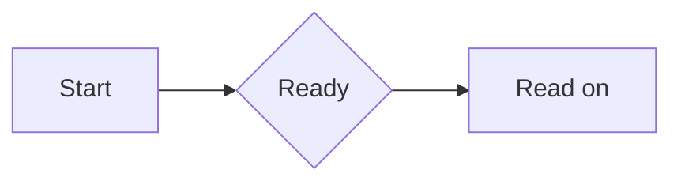

# Default syntax

> Reading note: this page uses LiMR syntax and interactive examples. Some content cannot be fully displayed by ordinary Markdown viewers such as GitHub; visit the [GitHub Pages documentation](https://linloir.github.io/LiMR/#/docs/en/syntax) for the best reading experience.

[Documentation](README.md) · [简体中文](../zh-CN/syntax.md)

**Modules** are configuration objects that add capabilities such as formulas, videos, or citations. A factory is called in application code to return an object; the module name is its `name` property, used for replacement and removal; tags and directives are the syntax written in Markdown. See [built-in modules](modules.md) for concepts and configuration.

The default modules below ship with `@linloir/limr`. `Reader`, standalone `Markdown`, and `DocumentProvider` enable all of them through `standard()` by default; core-only `createDocument()` starts with CommonMark. The following sections include source and rendered examples, using LiMR itself.

## Module catalog

| Factory (application code) | Module name (name) | Capability | Registered tags / directives |
| --- | --- | --- | --- |
| `gfm()` | `gfm` | Tables, strikethrough, tasks, autolinks, standard footnotes | `::gfm` |
| `math()` | `math` | Inline and display math | `$…$`, `$$…$$`, `::math` |
| `codeHighlight()` | `code-highlight` | Shiki fenced-code highlighting | Standard code fences, `::code` / `::code-highlight` |
| `definition()` | `definition` | Definitions | Tags / directives: definition, title, content |
| `question()` | `question` | Exercises and answers | Tags / directives: question and child names below |
| `extras()` | `extras` | Further reading | Tags / directives: extras, extra |
| `video()` | `video` | Native video, YouTube, Bilibili | Tags / directives: video, md-video |
| `figures()` | `figures` | Figure groups and captions | Tags / directives: figures, figure, figcaption, caption, img |
| `citation()` | `citation` | Reference definitions and markers | Tags / directives: citation, ref |
| `translations()` | `translations` | Original, translated, and parallel text | Tags and directives: translations, origin, translation |
| `mermaid()` | `mermaid` | Mermaid diagrams | Mermaid fences, `::mermaid` |
| `callout()` | `callout` | Typed, titled and collapsible quotes | `> [!type]`, `::callout` |
| `inlineHighlights()` | `inline-highlights` | Source-authored highlights | `==text==`, `::highlight` |
| `footnotes()` | `footnotes` | Comment markers and footnote cards | `[^id]`, `^[body]`, `::footnote`, `::footnote-ref` |
| `sourceAnnotations()` | `source-annotations` | Named ranges and Markdown-stored annotations | `[^%%limr:id%%]`, `::limr-annotation` |

These are registered static tags in Markdown, not an arbitrary MDX/HTML execution environment. Use string attributes such as `multi="true"` and `answer="[0,2]"`. Do not use `answer={[0,2]}`, event functions, or spread attributes. Unregistered HTML is displayed as text; expressions are not executed and may produce diagnostics. Keep blank lines between block tags and their Markdown content.

## CommonMark and GFM

````markdown
# Heading

**Bold**, *italic*, ~~deleted~~, [link](https://example.com), `inline code`.

> A blockquote, labelled Note by the default renderer.

- A list item
- [x] Complete
- [ ] Pending

| Name | Description |
| --- | --- |
| LiMR | Markdown renderer |

```typescript
const value = 42;
```

A standard footnote[^note].

[^note]: Footnote content in a sidebar or floating card.
````

Rendered result (interactive where applicable):

#### Example heading

**Bold**, *italic*, ~~deleted~~, [link](https://example.com), `inline code`.

> A blockquote, labelled Note by the default renderer.

- A list item
- [x] Complete
- [ ] Pending

| Name | Description |
| --- | --- |
| LiMR | Markdown renderer |

```typescript
const value = 42;
```

A standard footnote[^syntax-note].

[^syntax-note]: Footnote content in a sidebar or floating card.

Default `[^note]` footnotes use markers and cards. Remove the `footnotes` module to restore traditional GFM endnotes. Ordinary Markdown supports ``. Raw HTML is not passed through to the DOM. Register an extension or override `components` to customize rendering.

## Math and code

```markdown
Inline: $E = mc^2$.

$$
\int_0^1 x^2\,dx = \frac{1}{3}
$$
```

Rendered result (interactive where applicable):

Inline: $E = mc^2$.

$$
\int_0^1 x^2\,dx = \frac{1}{3}
$$

Import `@linloir/limr/math.css`. Configure formulas with `math({ macros, strict })`. Fenced language names select Shiki highlighting. Highlighting loads near the viewport; streaming code waits for closure and for native selections to leave before applying colors. Code over the default 100,000-character limit, unsupported languages, and languages outside the configured list retain readable source. Configure `codeHighlight({ languages, lightTheme, darkTheme, eager, maxLength })`.

## Definitions

```markdown
<definition title="Entropy">

A measure of uncertainty: $H(X)$.

</definition>
```

Rendered result (interactive where applicable):

<definition title="Entropy">

A measure of uncertainty: $H(X)$.

</definition>

Use child tags for rich titles and an explicit body:

```markdown
<definition>

<title>**Entropy** / 熵</title>

<content>

The body supports Markdown.

</content>

</definition>
```

The `title` attribute is text. Child tags support rich content. The directive form is `:::definition{title="Entropy"}`, closed by `:::`.

## Exercises

```markdown
<question title="Which numbers are even?">

<question-content>Select all correct options.</question-content>

<question-sel-grp multi="true" answer="[0,2]">

<question-sel>2</question-sel>

<question-sel>3</question-sel>

<question-sel>4</question-sel>

</question-sel-grp>

<question-hint>Consider divisibility by 2.</question-hint>

<question-answer>2 and 4 are even.</question-answer>

</question>
```

Rendered result (interactive where applicable):

<question title="Which numbers are even?">

<question-content>Select all correct options.</question-content>

<question-sel-grp multi="true" answer="[0,2]">

<question-sel>2</question-sel>

<question-sel>3</question-sel>

<question-sel>4</question-sel>

</question-sel-grp>

<question-hint>Consider divisibility by 2.</question-hint>

<question-answer>2 and 4 are even.</question-answer>

</question>

Answer indices are **zero-based**. `multi` is off by default. `answer` is a string containing a JSON array or a single index. Attributes on the selection group take precedence over question attributes. Hints and answers expand independently; configured answers enable submission, scoring, and retry. This module neither connects to AI nor creates question annotations.

## Further reading

```markdown
<extras>

<extra title="Read more" url="https://example.com/article" desc="Background material." />

</extras>
```

Rendered result (interactive where applicable):

<extras>

<extra title="Built-in modules" url="https://linloir.github.io/LiMR/#/docs/en/modules" desc="Background material." />

</extras>

`extra` uses `title`, `url`, and `desc`. Links pass through the built-in URL filter.

## Citation cards

```markdown
One source<ref id="a" />, or several<ref ids='["a","b"]' />.

<ref id="a">Referenced **text**</ref>

<citation id="a" title="Source A" url="https://example.com/a" description="Full **Markdown** description." summary="Short collapsed summary." />

<citation cite-id="b" title="Source B" url="https://example.com/b" desc="Legacy attribute name." />
```

Rendered result (interactive where applicable):

One source<ref id="a" />, or several<ref ids='["a","b"]' />.

<ref id="a">Referenced **text**</ref>

<citation id="a" title="Source A" url="https://example.com/a" description="Full **Markdown** description." summary="Short collapsed summary." />

<citation cite-id="b" title="Source B" url="https://example.com/b" desc="Legacy attribute name." />

Citation IDs use `cite-id`, then `id`. Descriptions use `desc`, then `description`. References use `cite-from-ids`, `ids`, then `id`, accepting JSON arrays or comma-separated strings. Definitions do not occupy body space, and multiple markers can reference one definition.

Citations do not expand into large cards by default; clicking pins the preview. Collapsed summaries fall back through `summary → description → safe URL → title`, with Markdown stripped. Card content uses description, then summary. `<ref id="a">text</ref>` temporarily highlights its explicit content when hovered or activated, without saving a highlight. A self-closing `<ref id="a" />` is a zero-length reference at the marker position and does not paint its paragraph. External range annotations use their bound range. See [annotations and selection](annotations.md).

## Images, figures, and captions

```markdown
<figures columns="2" min-width="220" max-width="560" max-height="480">

<figure src="/figures/a.png" alt="Experiment A" caption="(a) Experiment A" />

<figure id="experiment-b">


<figcaption>**(b)** A Markdown caption.</figcaption>

</figure>

<figcaption>Figure 1 · Two experiments.</figcaption>

</figures>
```

Rendered result (interactive where applicable):

<figures columns="2" min-width="220" max-width="560" max-height="480">

<figure src="../assets/source.svg" alt="Experiment A" caption="(a) Experiment A" />

<figure id="experiment-b">


<figcaption>**(b)** A Markdown caption.</figcaption>

</figure>

<figcaption>Figure 1 · Two experiments.</figcaption>

</figures>

A figure can stand alone. Supply an image through `src` / `url`, nested Markdown, or ``. Use one image per figure and figures for groups. Captions can use an attribute or figcaption / caption child tags; use children for rich text. `id` provides an in-page link target.

| Attribute | Default | Meaning |
| --- | --- | --- |
| `min-width` / `min-height` | 220 / 120 | Determines when another column fits; narrow containers take priority |
| `max-width` / `max-height` | 560 / 480 | Image bounds preserving aspect ratio; none / false removes a bound |
| `columns` / `cols` | Automatic | Requested columns, capped at 24 |
| `rows` | Automatic | Derives columns from image count when columns are omitted |
| `responsive` | true | Reduces explicit columns when space is insufficient; false keeps them |
| `gap` | 16 | Group gap in pixels |

Dimensions accept nonnegative numbers or px. Figures inherit group limits and can override them. Factory options use camelCase, such as `figures({ maxHeight: 360, maxWidth: false })`. Images retain their aspect ratio, and captions are not cropped. A single figure copies the image URL; a group copies Markdown source. Neither copies image bytes.

Directive example:

```markdown
:::figures{columns="2"}
::figure{src="/a.png" caption="A"}
::figure{src="/b.png" caption="B"}
:::
```

## Video

```markdown
<video src="/demo.mp4" provider="native" title="Demo" />

<md-video url="https://www.youtube.com/watch?v=dQw4w9WgXcQ" loading="click" />

<video url="https://www.bilibili.com/video/BV1xx411c7mD/?p=2" />
```

`url` takes precedence over `src`. `provider` defaults to auto and also accepts native, youtube, and bilibili. YouTube supports watch, short, embed, shorts, and live URLs with start times. Bilibili supports BV/av IDs and parts. Other attributes are title and loading.

**The default is `loading="visible"`**: the player mounts within 200px of the viewport without autoplay. click waits for a click; eager mounts immediately. Set a module default with `video({ loading: 'click' })`. Actual playback depends on the platform, network, and embedding permissions; local iframe tests do not guarantee remote playback. Use `video({ resolveUrl })` for a custom provider.

Click-to-load example (no player is created before clicking):

<video url="https://www.youtube.com/watch?v=dQw4w9WgXcQ" loading="click" title="Video example" />

## Translations

```markdown
<translations default="both">

<origin>

Original **Markdown**.

</origin>

<translation>

翻译后的 **Markdown**。

</translation>

</translations>
```

Rendered result (interactive where applicable):

<translations default="both">

<origin>

Original **Markdown**.

</origin>

<translation>

翻译后的 **Markdown**。

</translation>

</translations>

`default` accepts origin, translation, or both, defaulting to origin unless overridden by the factory's defaultMode. The marker cycles through these modes. Parallel mode shows the translation first. During streaming, an available side is shown while the other is missing. This module does not translate content automatically.

Global `parameters.translationMode` overrides individual blocks. Pass onTranslationModeChange to accept marker requests; without a callback, a global mode is locked. Setting it to undefined restores local choices. See [application integration](integration.md).

## Selection and replacement

Toolbar-authored highlights are annotations; source-authored `==highlights==` default to a copy-only toolbar. Supplying `onSourceChange` makes the default toolbar’s highlight creation/edits and task toggles update Markdown; modules can also add source annotations with target: source. Ordinary addAnnotation stays external; see [application integration](integration.md). All registered default tags also support their matching `::` directive. Register plugins for custom tags. See [extension development](extensions.md) to select or replace default modules.

## Two-colon components

All default modules accept the [CoMark component form](https://comark.dev/syntax/components), including nesting, scalar attributes, and Markdown children:

```md
::definition{title="A definition"}
**Rich** Markdown content.
::

::question{title="A question"}
::question-content
The prompt.
::
::question-answer
The answer.
::
::
```

Names: `gfm`, `definition`, `title`, `content`, `question` and its existing child tags, `extras`, `extra`, `video`, `md-video`, `figures`, `figure`, `figcaption`, `caption`, `img`, `citation`, `ref`, `translations`, `origin`, `translation`, `code` (alias `code-highlight`), `math`, `mermaid`, `callout`, `highlight`, `footnote`, `footnote-ref`, and `limr-annotation`. `::code{lang="typescript"}` and `::math` preserve their bodies literally. Standard Markdown fences, JSX, single-colon inline directives and existing triple-colon containers remain supported. An unpaired two-colon line in a finished document keeps its legacy leaf-directive meaning. This is component-syntax compatibility, not support for CoMark's YAML props, named slots or frontmatter.

During streaming, partial headers, links, inline code/emphasis/math delimiters and table headers are withheld until usable. Registered open components carry `incomplete`; the module chooses a loading view or progressive content. Code fences and display math can render before their closing delimiter. Set `streaming={false}` or call `finish()` to restore normal final Markdown interpretation. Source ranges always refer to the unmodified original input.

## Mermaid diagrams

````markdown

````

`::mermaid` is also supported. Open streaming blocks show a loading ring; completed diagrams load asynchronously and fade into view. The math-style surface has one rounded toolbar for copying source, zooming in/out, and switching source/image views. Selection, highlights and markers treat the whole diagram atomically in both views. Mermaid uses strict mode without diagram interaction callbacks.

Rendered result:


Drag to pan, or use arrow keys, Page Up/Down, Home/End and the wheel; Shift+wheel moves horizontally. Click or Enter selects the whole block with its selection toolbar below. Zoomed content scrolls within `--limr-mermaid-max-height`, defaulting to `min(70vh, 36rem)`. The diagram's own copy button copies its body; selection-toolbar and browser copying preserve the full fence or directive. See [styles](styles.md) and [atomic copying](annotations.md).

## Callouts and nested quotes

```markdown
> [!tip]+ Custom title
> A useful hint.
>
> > An ordinary nested quote.
> >
> > > [!warning]- Collapsible reminder
> > > With **Markdown** content.
```

Default types are `note`, `abstract`, `info`, `todo`, `tip`, `success`, `question`, `warning`, `failure`, `danger`, `bug`, `example`, and `quote`. Obsidian aliases are supported: summary/tldr, hint/important, check/done, help/faq, caution/attention, fail/missing, error, and cite. Types are case-insensitive; unknown names use note styling. `+` starts expanded, `-` starts collapsed, and no sign creates a regular block. The equivalent component is `::callout{type="tip" title="Title" fold="-"}`.

Rendered result; expand the nested reminder:

> [!tip]+ Custom title
> A useful hint.
>
> > An ordinary nested quote.
> >
> > > [!warning]- Collapsible reminder
> > > With **Markdown** content.

## Source highlights and footnotes

```markdown
==A blue highlight== offers copying without editing.

==A named note==[^note]

==An inline note==^[With **Markdown** content.]

[^note]: Footnote content.

    A second paragraph.
```

Highlights preserve rich inline formatting. Escaped punctuation, code and math do not create highlights. Override the blue through `--limr-inline-highlight` or `inlineHighlights({ color })`. Without source editing, their toolbar contains only a copy button and a single-line, left-aligned read-only hint.

Footnotes use rounded comment markers, sidebar items on wide readers, and floating cards on narrow readers. Adjacent footnotes reference precisely the highlighted text; standalone markers have zero-length ranges at their insertion positions. Named definitions can be reused, and their original label (such as `note`) appears in the card and sidebar. `::highlight`, `::footnote{id="note"}`, and `::footnote-ref{id="note"}` provide component forms. Removing the `footnotes` module restores GFM superscripts and endnotes.

Rendered result; click a highlight or comment marker:

==A blue highlight== offers copying without editing.

==A named note==[^syntax-source-highlight]

==An inline note==^[With **Markdown** content.]

[^syntax-source-highlight]: Footnote content.

    A second paragraph.


## Annotations stored in Markdown

`sourceAnnotations()` is included in `standard()`, after `inlineHighlights()` and `footnotes()`. A reserved footnote label binds a named range to one or more annotation definitions:

```markdown
abcd==efg==[^%%limr:r1%%]

[^%%limr:r1%%]: A fallback annotation for ordinary Markdown viewers.

:::limr-annotation{#h1 ranges="r1" type="highlight" style="background" color="#E5C07B" hidden="false"}
:::

:::limr-annotation{#n1 ranges="r1" type="footnote"}
A note with **Markdown**.
:::

:::limr-annotation{#q1 ranges="r1" type="question"}
Why check the cache first?
:::
```

`sourceAnnotations()` provides generic syntax and serialization, without registering a question card. In this example, highlight is built in, footnote comes from the default footnote module, and question requires a registered module. Playground uses the [reading notes example](../../examples/notes.tsx) for that type and card.

Only the exact, case-sensitive `[^%%limr:<id>%%]` spelling activates this mode. Use stable range IDs such as `r1`, `my-range`, or a UUID; `r1` and `R1` differ. IDs cannot contain whitespace, `%`, or `]`. URL-shaped labels are unsupported because Markdown autolink parsing can consume their source positions. The fallback `[^%%limr:r1%%]:` definition is optional and hidden by LiMR. The `limr-annotation` bodies supply the annotation content. A standalone reserved marker also works, using a zero-length range.

| Field | Meaning |
| --- | --- |
| `#n1` or `id="n1"` | Annotation ID; the last definition with the same ID replaces earlier definitions |
| `ranges="r1 r2"` | Named ranges, separated by spaces or commas; the same range ID can appear in several places |
| `type` | Annotation type, such as `highlight`, `footnote`, or `question`; defaults to `footnote` |
| `style`, `color`, `hidden` | Highlight appearance; `hidden="true"` hides paint without deleting the annotation |
| Body | Markdown content exposed as `data.body`; other scalar attributes are passed to the owning annotation module |

A range can have several content annotations but only one effective highlight: the last highlight definition targeting that range wins. On reserved ranges, `==…==` names the content span. Without an explicit highlight, or with hidden=true, feedback appears only on hover, using highlight.color when supplied and otherwise the default inline highlight color. Visible explicit paint is drawn once, and every content annotation has its own marker. An annotation referencing an unknown range keeps its definition and has no visible occurrence until the range exists. Unknown annotation types preserve their data and referenced text, but have no annotation UI until a module registers the type.

The equivalent component forms are supported, including the two-colon fallback:

```markdown
<limr-annotation id="n1" ranges="r1" type="footnote">

A note with **Markdown**.

</limr-annotation>

::limr-annotation{#q1 ranges="r1" type="question"}
Why check the cache first?
::
```

Definitions may precede or follow their ranges. Streaming keeps incomplete definition headers and bodies hidden until the block closes, then resolves annotations against already parsed ranges. See [annotations and selection](annotations.md) for the source metadata and editing contract.
