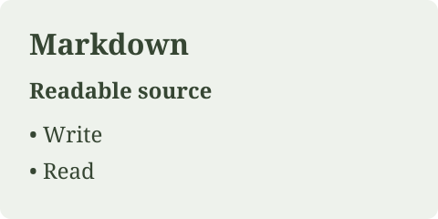
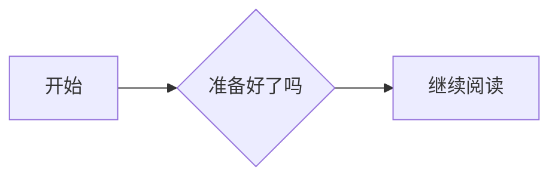

# 默认语法

> 阅读提示：本文包含 LiMR 扩展语法和交互示例。部分内容在 GitHub 等普通 Markdown 阅读器中无法完整展示；前往 [GitHub Pages 文档](https://linloir.github.io/LiMR/#/docs/zh-CN/syntax) 可获得最佳阅读体验。

[文档目录](README.md) · [English](../en/syntax.md)

**模块**是为 LiMR 增加一组能力的配置对象，例如公式、视频或引用。下面的“创建函数”在应用代码中调用，返回模块对象；“模块名”是对象的 `name` 字段，用于替换和移除；“标签 / 指令”才是写在 Markdown 正文中的语法。完整概念和配置方式见[内置模块](modules.md)。

`@linloir/limr` 随包提供以下默认模块。`Reader`、独立 `Markdown` 和 `DocumentProvider` 默认通过 `standard()` 全部启用；纯核心 `createDocument()` 默认只有 CommonMark。下面每节给出源码和实际效果，交互示例由 LiMR 自己渲染。

## 模块清单

| 创建函数（应用代码） | 模块名（name） | 默认能力 | 注册的特殊标签 / 指令 |
| --- | --- | --- | --- |
| `gfm()` | `gfm` | 表格、删除线、任务列表、自动链接、标准脚注 | `::gfm` |
| `math()` | `math` | 行内与块级公式 | `$…$`、`$$…$$`、`::math` |
| `codeHighlight()` | `code-highlight` | Shiki 围栏代码高亮 | 标准代码围栏、`::code` / `::code-highlight` |
| `definition()` | `definition` | 释义 | 标签 / 指令 `definition`、`title`、`content` |
| `question()` | `question` | 练习题与答案 | 标签 / 指令 `question` 及下文子标签 |
| `extras()` | `extras` | 拓展阅读 | 标签 / 指令 `extras`、`extra` |
| `video()` | `video` | 原生视频、YouTube、Bilibili | 标签 / 指令 `video`、`md-video` |
| `figures()` | `figures` | 图组与图注 | 标签 / 指令 `figures`、`figure`、`figcaption`、`caption`、`img` |
| `citation()` | `citation` | 引用定义与角标 | 标签 / 指令 `citation`、`ref` |
| `translations()` | `translations` | 原文、译文与对照 | 标签及指令 `translations`、`origin`、`translation` |
| `mermaid()` | `mermaid` | 流程图等 Mermaid 图表 | Mermaid 围栏、`::mermaid` |
| `callout()` | `callout` | 有类型、标题、折叠状态的注释块 | `> [!type]`、`::callout` |
| `inlineHighlights()` | `inline-highlights` | 源码内嵌高亮 | `==文字==`、`::highlight` |
| `footnotes()` | `footnotes` | 评论角标和脚注卡片 | `[^id]`、`^[正文]`、`::footnote`、`::footnote-ref` |
| `sourceAnnotations()` | `source-annotations` | 命名范围与保存在 Markdown 中的标注 | `[^%%limr:id%%]`、`::limr-annotation` |

这些是 Markdown 中允许的静态标签，不是任意 MDX/HTML 执行环境。使用字符串属性，如 `multi="true"`、`answer="[0,2]"`；不要使用 `answer={[0,2]}`、事件函数或展开属性。未注册 HTML 按文本显示；表达式不执行并可能产生诊断。嵌套块的标签和正文之间保留空行。

## CommonMark 与 GFM

````markdown
# 标题

**粗体**、*斜体*、~~删除线~~、[链接](https://example.com)、`行内代码`。

> 引用块，默认界面标题为 Note / 注释。

- 普通列表
- [x] 已完成
- [ ] 未完成

| 名称 | 说明 |
| --- | --- |
| LiMR | Markdown renderer |

```typescript
const value = 42;
```

标准脚注[^note]。

[^note]: 以角标和侧栏 / 窄屏卡片显示的脚注内容。
````

实际效果（可交互）：

#### 标题示例

**粗体**、*斜体*、~~删除线~~、[链接](https://example.com)、`行内代码`。

> 引用块，默认界面标题为 Note / 注释。

- 普通列表
- [x] 已完成
- [ ] 未完成

| 名称 | 说明 |
| --- | --- |
| LiMR | Markdown renderer |

```typescript
const value = 42;
```

标准脚注[^syntax-note]。

[^syntax-note]: 以角标和侧栏 / 窄屏卡片显示的脚注内容。

默认 `[^note]` 显示脚注角标和卡片；移除 `footnotes` 模块后，GFM 仍可渲染传统文末脚注。图片 `` 由普通 Markdown 支持。原始 HTML 不透传到 DOM；需要自定义外观时注册扩展或覆盖 `components`。

## 公式与代码

```markdown
行内公式：$E = mc^2$。

$$
\int_0^1 x^2\,dx = \frac{1}{3}
$$
```

实际效果（可交互）：

行内公式：$E = mc^2$。

$$
\int_0^1 x^2\,dx = \frac{1}{3}
$$

公式需要导入 `@linloir/limr/math.css`；支持通过 `math({ macros, strict })` 配置。代码围栏语言用于 Shiki 高亮。默认接近视口才加载高亮，流式代码等待语法闭合，且原生选区离开代码后再应用高亮；超过默认 100,000 字符、未支持或未在允许列表中的语言保留可读源码。`codeHighlight({ languages, lightTheme, darkTheme, eager, maxLength })` 可配置。

## 释义

```markdown
<definition title="熵">

表示不确定性的量：$H(X)$。

</definition>
```

实际效果（可交互）：

<definition title="熵">

表示不确定性的量：$H(X)$。

</definition>

富文本标题和指定正文可以使用子标签：

```markdown
<definition>

<title>**Entropy** / 熵</title>

<content>

正文支持 Markdown。

</content>

</definition>
```

`title` 属性按文字渲染；富文本用子标签。也可以写 `:::definition{title="熵"}`，以 `:::` 结束。

## 练习题

```markdown
<question title="哪些是偶数？">

<question-content>请选择所有正确选项。</question-content>

<question-sel-grp multi="true" answer="[0,2]">

<question-sel>2</question-sel>

<question-sel>3</question-sel>

<question-sel>4</question-sel>

</question-sel-grp>

<question-hint>考虑能否被 2 整除。</question-hint>

<question-answer>2 和 4 是偶数。</question-answer>

</question>
```

实际效果（可交互）：

<question title="哪些是偶数？">

<question-content>请选择所有正确选项。</question-content>

<question-sel-grp multi="true" answer="[0,2]">

<question-sel>2</question-sel>

<question-sel>3</question-sel>

<question-sel>4</question-sel>

</question-sel-grp>

<question-hint>考虑能否被 2 整除。</question-hint>

<question-answer>2 和 4 是偶数。</question-answer>

</question>

答案索引从 **0** 开始。`multi` 默认关闭；`answer` 可以是 JSON 数组或单个索引的字符串。属性优先读取选择组，其次读取 `question`。提示和答案可以单独展开，有答案索引时支持提交、判分和重试。它不连接 AI，也不创建问答标注。

## 拓展阅读

```markdown
<extras>

<extra title="继续阅读" url="https://example.com/article" desc="背景和补充材料。" />

</extras>
```

实际效果（可交互）：

<extras>

<extra title="内置模块" url="https://linloir.github.io/LiMR/#/docs/zh-CN/modules" desc="背景和补充材料。" />

</extras>

`extra` 使用 `title`、`url`、`desc`。链接经过内置 URL 过滤。

## 引用卡片

```markdown
一个来源<ref id="a" />，或一组来源<ref ids='["a","b"]' />。

<ref id="a">带引用的 **原文**</ref>

<citation id="a" title="资料 A" url="https://example.com/a" description="完整的 **Markdown** 说明。" summary="收起时的简短摘要。" />

<citation cite-id="b" title="资料 B" url="https://example.com/b" desc="兼容属性名。" />
```

实际效果（可交互）：

一个来源<ref id="a" />，或一组来源<ref ids='["a","b"]' />。

<ref id="a">带引用的 **原文**</ref>

<citation id="a" title="资料 A" url="https://example.com/a" description="完整的 **Markdown** 说明。" summary="收起时的简短摘要。" />

<citation cite-id="b" title="资料 B" url="https://example.com/b" desc="兼容属性名。" />

`citation` 的 ID 读取 `cite-id`，其次 `id`；说明读取 `desc`，其次 `description`。`ref` 读取 `cite-from-ids`、`ids`、`id`，支持 JSON 数组或逗号分隔字符串。定义本身不占正文位置，同一个定义可以被多个角标引用。

Citation 默认不提供展开大卡片，点击固定预览；摘要按 `summary → description → 安全 URL → title` 回退，去掉 Markdown 标记。正文显示 `description`，没有时显示 `summary`。`<ref id="a">文本</ref>` 在悬浮或激活时临时高亮其明确包裹的文本，不写入已保存高亮。自闭合的 `<ref id="a" />` 是角标位置上的零长度引用，不再高亮整个段落；外部范围标注使用绑定范围。配置与存储见[标注与选区](annotations.md)。

## 图片、图组与图注

```markdown
<figures columns="2" min-width="220" max-width="560" max-height="480">

<figure src="/figures/a.png" alt="实验 A" caption="(a) 实验 A" />

<figure id="experiment-b">


<figcaption>**(b)** 支持 Markdown 的图注。</figcaption>

</figure>

<figcaption>图 1 · 两个实验。</figcaption>

</figures>
```

实际效果（可交互）：

<figures columns="2" min-width="220" max-width="560" max-height="480">

<figure src="../assets/source.svg" alt="实验 A" caption="(a) 实验 A" />

<figure id="experiment-b">



<figcaption>**(b)** 支持 Markdown 的图注。</figcaption>

</figure>

<figcaption>图 1 · 两个实验。</figcaption>

</figures>

`figure` 可独立使用。图片可以来自 `src` / `url` 属性、内部 Markdown 图片或 ``。每个 figure 放一张图；多张图用 figures。图注可用 `caption` 属性或 `figcaption` / `caption` 子标签，富文本使用子标签。`id` 可作为页内链接目标。

| 属性 | 默认值 | 说明 |
| --- | --- | --- |
| `min-width` / `min-height` | 220 / 120 | 决定何时增加列，窄容器优先适应宽度 |
| `max-width` / `max-height` | 560 / 480 | 保持比例的图片上限；`none` / `false` 取消上限 |
| `columns` / `cols` | 自动 | 指定列数，最多 24 |
| `rows` | 自动 | 未指定列数时由图数推导列数 |
| `responsive` | true | 容器不足时降低显式列数；false 保留列数 |
| `gap` | 16 | 图组间距，像素 |

尺寸接受非负数字或 `px`。图组限制由子图继承，子图可以覆盖。对应工厂参数为驼峰命名，例如 `figures({ maxHeight: 360, maxWidth: false })`。图片不变形、不裁切图注。单图复制按钮复制图片 URL；图组复制按钮复制 Markdown 源码，不下载图片二进制。

指令示例：

```markdown
:::figures{columns="2"}
::figure{src="/a.png" caption="A"}
::figure{src="/b.png" caption="B"}
:::
```

## 视频

```markdown
<video src="/demo.mp4" provider="native" title="演示" />

<md-video url="https://www.youtube.com/watch?v=dQw4w9WgXcQ" loading="click" />

<video url="https://www.bilibili.com/video/BV1xx411c7mD/?p=2" />
```

`url` 优先于 `src`；`provider` 默认 `auto`，还可以是 `native`、`youtube`、`bilibili`。YouTube 支持 watch、短链接、embed、shorts、live 和起始时间；Bilibili 支持 BV/av 与分 P。支持 `title` 和 `loading`。

**默认 `loading="visible"`**：在视口附近 200px 挂载播放器，不自动播放。`click` 等待点击，`eager` 立即挂载。可以用 `video({ loading: 'click' })` 设置模块默认值。平台、网络和嵌入权限仍会影响真实播放；不能把本地 iframe 测试当作远程播放保证。自定义平台通过 `video({ resolveUrl })` 接入。

点击加载的视频示例（点击前不创建播放器）：

<video url="https://www.youtube.com/watch?v=dQw4w9WgXcQ" loading="click" title="视频示例" />

## 分段译文

```markdown
<translations default="both">

<origin>

Original **Markdown**.

</origin>

<translation>

翻译后的 **Markdown**。

</translation>

</translations>
```

实际效果（可交互）：

<translations default="both">

<origin>

Original **Markdown**.

</origin>

<translation>

翻译后的 **Markdown**。

</translation>

</translations>

`default` 为 `origin`、`translation` 或 `both`，未指定时默认 `origin`（可用工厂 `defaultMode` 改写）。角标依次切换原文、译文、对照；对照时译文在前。流式输入只有一侧时先显示已有内容。模块不提供自动翻译服务。

全局 `parameters.translationMode` 覆盖各块；传 `onTranslationModeChange` 接受角标发出的更改请求，否则全局模式锁定。设回 `undefined` 恢复各块的本地选择。见[项目集成](integration.md)。

## 选择与替换

工具栏创建的高亮存为 annotation；`==高亮==` 由源码定义，默认只提供复制工具栏。传入 `onSourceChange` 后，默认工具栏创建或修改的高亮、任务勾选会保存到 Markdown；模块也可用 target: source 添加源内标注。常规 addAnnotation 仍保存外部数据，详见[项目集成](integration.md)。默认模块的全部已注册标签都支持同名 `::` 指令。自定义标签需注册插件。使用完整清单配置或替换默认模块，见[扩展开发](extensions.md)。

## 双冒号组件写法

所有默认模块都支持 [CoMark 的组件写法](https://comark.dev/syntax/components)，包括嵌套、标量属性和 Markdown 正文：

```md
::definition{title="定义"}
支持 **富文本** 的正文。
::

::question{title="一道题"}
::question-content
题目内容。
::
::question-answer
答案内容。
::
::
```

可用名称包括 `gfm`、`definition`、`title`、`content`、`question` 及其已有子标签、`extras`、`extra`、`video`、`md-video`、`figures`、`figure`、`figcaption`、`caption`、`img`、`citation`、`ref`、`translations`、`origin`、`translation`、`code`（别名 `code-highlight`）、`math`、`mermaid`、`callout`、`highlight`、`footnote`、`footnote-ref`、`limr-annotation`。`::code{lang="typescript"}` 与 `::math` 的正文保持字面量。

标准 Markdown 围栏、JSX、单冒号行内指令和原有三冒号容器继续可用。最终文档中没有配对闭合的双冒号行，保留原有 leaf directive 语义。这里兼容的是组件语法，不包含 CoMark 的 YAML 属性、命名插槽和 frontmatter。

流式过程中，半截头部、链接、行内代码/强调/公式符号和表头会暂缓显示；已识别但未闭合的组件携带 `incomplete`，由模块选择 loading 或渐进内容。代码围栏和块公式可在闭合前展示。结束时设置 `streaming={false}` 或调用 `finish()`，恢复普通 Markdown 的最终解释。所有范围始终对应未改写的原始输入。

## Mermaid 图表

````markdown

````

也可使用 `::mermaid`。流式闭合前显示 loading，完成后异步加载 Mermaid 并淡入图像。背景与公式块一致，右上角共用圆角工具栏提供复制源码、放大、缩小、源码 / 图像切换。选区、高亮和角标以整张图为单位；源码视图不改变这个原子选择约定。图表使用 Mermaid strict 模式，不执行图中的交互回调。

实际效果：


图像模式支持拖动平移、方向键、Page Up/Down、Home/End 和滚轮，Shift + 滚轮横向移动；点击或 Enter 整块选择，选区工具栏位于块下方。放大后的内容在最大高度内滚动，`--limr-mermaid-max-height` 默认 `min(70vh, 36rem)`。操作栏“复制”获取图表正文，选区工具栏及浏览器复制保留完整围栏或指令。详见[样式与字体](styles.md)和[整体复制](annotations.md)。

## Callout 与嵌套注释

```markdown
> [!tip]+ 自定义标题
> 提示正文。
>
> > 普通的嵌套注释。
> >
> > > [!warning]- 可折叠的提醒
> > > 支持 **Markdown**。
```

默认类型为 `note`、`abstract`、`info`、`todo`、`tip`、`success`、`question`、`warning`、`failure`、`danger`、`bug`、`example`、`quote`，别名对齐 Obsidian：summary/tldr、hint/important、check/done、help/faq、caution/attention、fail/missing、error、cite。大小写不敏感，未知类型沿用 note 外观。`+` 初始展开，`-` 初始折叠；不写符号时为普通块。另支持 `::callout{type="tip" title="标题" fold="-"}`。

实际效果，可展开内部的提醒：

> [!tip]+ 自定义标题
> 提示正文。
>
> > 普通的嵌套注释。
> >
> > > [!warning]- 可折叠的提醒
> > > 支持 **Markdown**。

## 源码高亮与脚注

```markdown
==默认蓝色高亮==，点击后只能复制。

==有脚注的高亮==[^note]

==内联脚注==^[这里可以写 **Markdown**。]

[^note]: 脚注正文。

    脚注的第二段。
```

高亮支持内部富文本，转义字符、代码和公式中的 `==` 保持字面量。高亮颜色可由 CSS `--limr-inline-highlight` 或 `inlineHighlights({ color })` 覆盖。未启用源码编辑时，工具栏只提供复制按钮和左对齐提示“Markdown 内嵌高亮，不支持编辑”；提示按操作按钮行的可用宽度换行。

脚注显示圆润评论角标；宽屏为侧栏条目，窄屏为悬浮卡片。卡片和侧栏会显示命名脚注的原始标签，例如 `note`。紧邻高亮的脚注引用这段高亮，独立脚注的范围为角标位置上的零长度；命名脚注可重复引用。`::highlight`、`::footnote{id="note"}` 和 `::footnote-ref{id="note"}` 可表达相同模块的容器形式。移除 `footnotes` 模块可恢复 GFM 的上标和文末脚注。

实际效果，点击高亮或评论角标：

==默认蓝色高亮==，点击后只能复制。

==有脚注的高亮==[^syntax-source-highlight]

==内联脚注==^[这里可以写 **Markdown**。]

[^syntax-source-highlight]: 脚注正文。

    脚注的第二段。


## 保存在 Markdown 中的标注

`standard()` 默认在 `inlineHighlights()` 和 `footnotes()` 后启用 `sourceAnnotations()`。使用保留的脚注标签，把命名范围关联到一条或多条标注定义：

```markdown
abcd==efg==[^%%limr:r1%%]

[^%%limr:r1%%]: 普通 Markdown 阅读器使用的兜底说明。

:::limr-annotation{#h1 ranges="r1" type="highlight" style="background" color="#E5C07B" hidden="false"}
:::

:::limr-annotation{#n1 ranges="r1" type="footnote"}
这是一条普通笔记，可以使用 **Markdown**。
:::

:::limr-annotation{#q1 ranges="r1" type="question"}
为什么这里需要先检查缓存？
:::
```

`sourceAnnotations()` 只负责通用语法与序列化，不注册提问卡片。上例的 highlight 是内置类型，footnote 由默认脚注模块提供，question 需由模块注册；Playground 使用[阅读笔记示例](../../examples/notes.tsx)提供该类型及卡片。

只有严格匹配、区分大小写的 `[^%%limr:<id>%%]` 才激活此模式。建议使用 `r1`、`my-range` 或 UUID 这样的稳定范围 ID；`r1` 与 `R1` 不同。ID 不含空白、`%` 或 `]`。不支持 URL 形式的标签，Markdown 自动链接解析可能消耗其源码位置。`[^%%limr:r1%%]:` 兜底定义可省略，LiMR 隐藏该定义，以 `limr-annotation` 的正文作为标注内容。也支持没有紧邻高亮的保留角标，此时范围长度为零。

| 字段 | 含义 |
| --- | --- |
| `#n1` 或 `id="n1"` | 标注 ID；同 ID 的最后一条定义覆盖前面的定义 |
| `ranges="r1 r2"` | 用空白或逗号分隔的命名范围；同一个范围 ID 可在多处出现 |
| `type` | 标注类型，如 `highlight`、`footnote`、`question`；默认 `footnote` |
| `style`、`color`、`hidden` | 高亮外观；`hidden="true"` 只隐藏绘制，不删除标注 |
| 正文 | Markdown 内容，通过 `data.body` 交给标注模块；其他标量属性也交给对应模块 |

一个范围可以关联多条内容标注，但最多生效一个高亮：最后一个指向该范围的高亮定义覆盖之前的高亮。保留范围中的 `==…==` 只声明文本跨度；没有显式 highlight 或 hidden=true 时仅悬浮显色，优先使用 highlight.color，再回退到默认内联高亮色。可见的显式高亮只绘制一次；每条内容标注各有独立角标。引用尚不存在范围的标注会保留定义，直到范围出现才显示角标；未知标注类型保留数据和所引用的正文，直到模块注册该类型才显示标注界面。

同样支持 HTML 组件形式和双冒号兜底形式：

```markdown
<limr-annotation id="n1" ranges="r1" type="footnote">

这是一条支持 **Markdown** 的笔记。

</limr-annotation>

::limr-annotation{#q1 ranges="r1" type="question"}
为什么这里需要先检查缓存？
::
```

定义可在命名范围之前或之后。流式期间，不完整的定义头部和正文保持隐藏，块闭合后再与已经解析的范围关联。源码元数据和编辑约定详见[标注与选区](annotations.md)。
