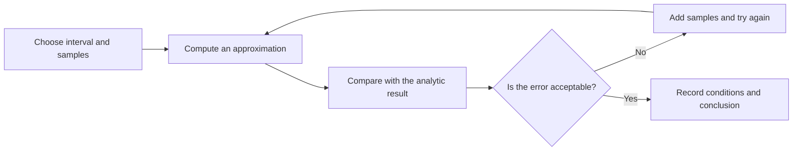

# Make complex ideas clear

Inline mathematics such as $E = mc^2$, code such as `const answer = 42`, and ordinary prose can share a selection. Technical reading often moves between a derivation, a program, and an explanation. This small example brings those different forms into one document.

## Start with a function

Let $f(x)=x^2$. Its definite integral over $[0,1]$ can be evaluated directly:

$$
\int_0^1 x^2 \, dx = \left[\frac{x^3}{3}\right]_0^1 = \frac{1}{3}.
$$

This answer also gives us a reference for a numerical program. The program does not need to prove the integration formula. We can compare a discrete approximation with the known result and investigate how the step size affects the error.

## Discretization and the trapezoidal rule

Divide the interval into $n$ equal parts, let $h=(b-a)/n$, and write $x_i=a+ih$. The trapezoidal rule approximates the area under the curve with a sum of trapezoid areas:

$$
T_n = h\left[\frac{f(a)+f(b)}{2}+\sum_{i=1}^{n-1}f(x_i)\right].
$$

The two endpoint values receive half weight. That detail is worth a note: each interior sample belongs to two adjacent trapezoids, while each endpoint belongs to only one.

```typescript
function integrate(
  f: (x: number) => number,
  a: number,
  b: number,
  steps = 100,
): number {
  if (!Number.isInteger(steps) || steps < 1) {
    throw new RangeError('steps must be a positive integer');
  }
  const width = (b - a) / steps;
  let sum = (f(a) + f(b)) / 2;
  for (let index = 1; index < steps; index++) {
    sum += f(a + index * width);
  }
  return sum * width;
}

const estimate = integrate(x => x * x, 0, 1, 100);
console.log({ estimate, error: Math.abs(estimate - 1 / 3) });
```

Select just the expression inside the loop, or extend a selection from the preceding explanation into the code. Copy preserves the visible text; highlights and annotations attach to the corresponding source range.

## Understand the result through its error

For $f(x)=x^2$ on this interval, the trapezoidal rule has an error of $1/(6n^2)$. Doubling the number of samples reduces the error to one quarter. Values in the table are rounded for reading; the program still computes with floating-point numbers.

| Samples $n$ | Approximation $T_n$ | Absolute error |
| ---: | ---: | ---: |
| 10 | 0.33500000 | 0.00166667 |
| 20 | 0.33375000 | 0.00041667 |
| 100 | 0.33335000 | 0.00001667 |
| 200 | 0.33333750 | 0.00000417 |

> To check a numerical result, first ask how the error changes with the input. Then ask how many decimal places the screen displays.

Select “reduces the error to one quarter” and add a question: would the same relationship hold for a function that is not smooth enough?

## A more general expression

Many problems require us to work with a group of parameters. For a parameter vector $\theta$ and a loss function $L(\theta)$, one gradient-descent step is:

$$
\theta_{t+1}=\theta_t-\eta\nabla L(\theta_t).
$$

Here $\eta$ is the step size. The compact notation contains several separate decisions: how to define the loss, compute its gradient, choose a step size, and stop the updates. Separate notes on those choices are easier to revisit than one crowded explanation beside the equation.

```python
from collections.abc import Callable

def descend(gradient: Callable[[float], float], start: float,
            rate: float = 0.1, iterations: int = 20) -> list[float]:
    values = [start]
    for _ in range(iterations):
        values.append(values[-1] - rate * gradient(values[-1]))
    return values

# L(x) = (x - 3)^2, so its derivative is 2(x - 3).
trajectory = descend(lambda x: 2 * (x - 3), start=0)
print(trajectory[-1])
```

## Keep these relationships in the reader

A reading interface needs to support both continuous reading and small local actions. Code, equations, and tables belong to the argument; notes and highlights belong to the reader's attempt to understand it. Sharing one coordinate system makes those connections easier to find again.

```tsx
import { Reader } from '@linloir/limr';
import { useState } from 'react';
import type { Annotation } from '@linloir/limr';

export function ReadingRoom({ source }: { source: string }) {
  const [annotations, setAnnotations] = useState<readonly Annotation[]>([]);
  return <Reader source={source}
    annotations={annotations}
    onAnnotationsChange={setAnnotations}
  />;
}
```

## A reading checklist

- [ ] Leave a footnote on a condition used in an equation.
- [ ] Add both a note and a question to the same code passage.
- [ ] Underline an individual expression in the code.
- [ ] Check that copied text preserves symbols and spaces.
- [ ] Resize the window and observe the tables and annotations.

## Return from the answer to the assumptions

Technical reading can easily overlook the question “under what conditions is this method useful?” Return to the integral: do the samples have to be equally spaced? Is the function continuous on the interval? Does every sample cost the same amount to compute? What happens to the sign if we reverse the endpoints? Questions like these turn a finished example into the beginning of another investigation.

## Draw the reasoning



Zoom, pan, or switch the diagram to its source. Selecting and copying the diagram preserves its complete syntax.

> [!info]+ Look at the error before the decimal places
> The table, equations, code, and diagram describe the same chain of reasoning. Connecting them is more useful than remembering one result in isolation.

::definition{title="Convergence"}
As a discretization becomes finer, its approximation approaches a definite limit. A definition can combine **formatted prose**, inline code such as `steps`, and mathematical notation such as $n$.
::

::question{title="Which two checks help validate a numerical program?"}
::question-content
Choose every suitable approach.
::
::question-sel-grp{multi="true" answer="[0,2]"}
::question-sel
Compare against a simple input with an analytic solution.
::
::question-sel
Only check that the output contains enough decimal places.
::
::question-sel
Change the sample count and observe how the error changes.
::
::
::question-hint
Check both the value and how it responds to changes in the input.
::
::question-answer
The first and third approaches. One precise-looking output cannot replace a check of the algorithm's behavior.
::
::

## Two ways to read

<translations default="origin">

<origin>
A useful numerical result explains both its value and the conditions under which it can be trusted.

</origin>

<translation>
有用的数值结果不仅给出数值，还说明我们在什么条件下可以相信它。

</translation>

</translations>

<extras>

<extra title="Return to the definition" url="https://en.wikipedia.org/wiki/Trapezoidal_rule" desc="Keep a path back to the material behind the explanation." />

</extras>
